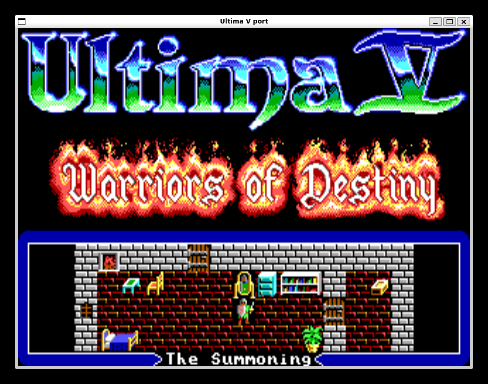
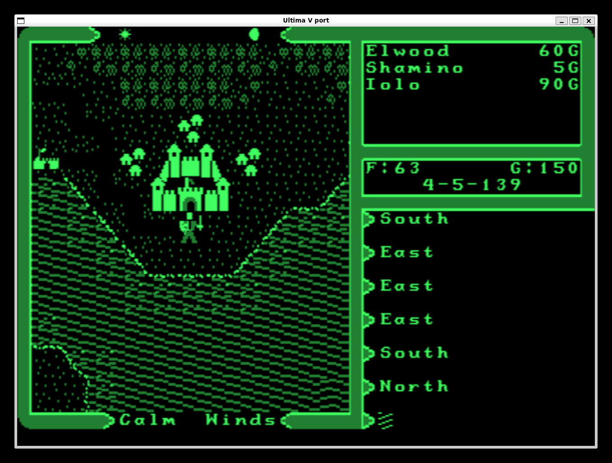

# Ultima V in SDL

A port of *Ultima V: Warriors of Destiny* (the 1988 DOS version) to C and SDL2, made from the
decompiled original. It plays the whole game - title sequence, character creation, towns,
dungeons, combat, magic, the endings - using the original game's data files, and can stand in
for three of the original graphics drivers: EGA, CGA and Hercules.

**You need your own copy of the original game, and it must be the IBM PC (MS-DOS) version.**
Ultima V was released for many machines - Apple II, Commodore 64 and 128, Atari ST, Amiga, NES,
PC-98 and others - and their files are in different formats that this port cannot read. Only the
files of the IBM PC release work. This repository contains no pictures, maps or sound from the
game; the port reads them from the game directory at run time.

## Screenshots

| EGA | Hercules (green screen) |
|---|---|
|  |  |

<!-- Placeholders: put ega.png and hercules-green.png in docs/screenshots/. -->

## Requirements

- The files of the **IBM PC (MS-DOS) version** of the game in one directory. You can tell it is
  the right version by these files: `ULTIMA.EXE`, `DATA.OVL` and the other `*.OVL` overlays,
  `EGA.DRV`, `CGA.DRV`, `HER.DRV`, `TILES.16`, `TILES.4`, `BRIT.DAT`, `SAVED.GAM`. If the game came
  on several floppy disks, copy the contents of all of them into the one directory. File names
  may be upper or lower case. Files from any other platform's release will not work.
- A C compiler and `make`.
- SDL2 development files. On Debian, Ubuntu or WSL: `sudo apt install build-essential libsdl2-dev`

## Build

```
make build/u5sdl
```

Everything that is built goes to `build/`.

## Run

```
build/u5sdl /path/to/ultima5
```

or `make run GAME=/path/to/ultima5`.

It starts like the original: the Origin logo, Lord British's signature, the title, then the demo
and the main menu (Journey Onward, Create New Character, Transfer from Ultima IV, Introduction,
Acknowledgements). The game directory is never written to: saved games go to `./u5save`
(change it with `-w`). A saved game already in the game directory is used until you save.

### Options

```
build/u5sdl [-v ega|cga|herc] [-p green|amber|white] [-4] [-s scale] [-j | -m] [-w save dir] <game dir>
```

| Option | Meaning |
|---|---|
| `-v ega` | 16 colours, 320×200 (the default) |
| `-v cga` | 4 colours, 320×200 |
| `-v herc` | Hercules monochrome, 640×300; `-v hercraw` shows its dots unblended |
| `-p green\|amber\|white` | colour of the Hercules monitor (default green) |
| `-4` | stretch the picture to 4:3, as a PC monitor showed it |
| `-s n` | window scale (default 3) |
| `-m` | skip the title sequence and start at the menu |
| `-j` | skip the menu too: Journey Onward with the saved game |
| `-w dir` | where saved games are written (default `./u5save`) |

Examples:

```
build/u5sdl -4 /path/to/ultima5              # EGA, 4:3
build/u5sdl -v herc /path/to/ultima5         # Hercules on a green screen
build/u5sdl -v herc -p amber /path/to/ultima5
build/u5sdl -v cga -j /path/to/ultima5       # CGA, straight into the saved game
```

### Keys

The keys are the original's.

- **Arrow keys** move (Shift + keypad also works).
- **Letters** are the commands: `A`ttack, `B`oard, `C`ast, `E`nter, `F`ire, `G`et, `H`ole up,
  `I`gnite torch, `J`immy, `K`limb, `L`ook, `M`ix, `N`ew order, `O`pen, `P`ush, `Q`uit and save,
  `R`eady, `S`earch, `T`alk, `U`se, `V`iew, `X`-it, `Y`ell, `Z`tats.
- **0-6** set the active player. **Space** passes a turn.
- **Ctrl-S** switches the sound on and off. **Ctrl-E** exits; closing the window quits too.
- In dungeons: left and right turn, up advances, down backs up.

`Q` saves the game; nothing is saved when you just close the window.

## Tests

```
make check GAME=/path/to/ultima5
```

builds and runs the headless tests in `build/`. They play scripted parts of the game against the
real data files and leave screenshots (`build/*.ppm`) and logs there.

## Layout

| Directory | Contents |
|---|---|
| `src/` | the ported game and the SDL front end (`sdl_main.c`, `sdl_platform.c`) |
| `test/` | headless tests and their scripted platform |
| `build/` | binaries and test output (not in git) |
| `docs/screenshots/` | pictures for this page |

`src/data.c` and `src/data.h` are generated from the game's `DATA.OVL` by the reverse-engineering
project's `gen_data.py`; they are not edited by hand.

## Not included

- The Tandy driver (`T1K.DRV`).
- The original's disk-swap prompts and copy to hard disk: the port reads one directory.
